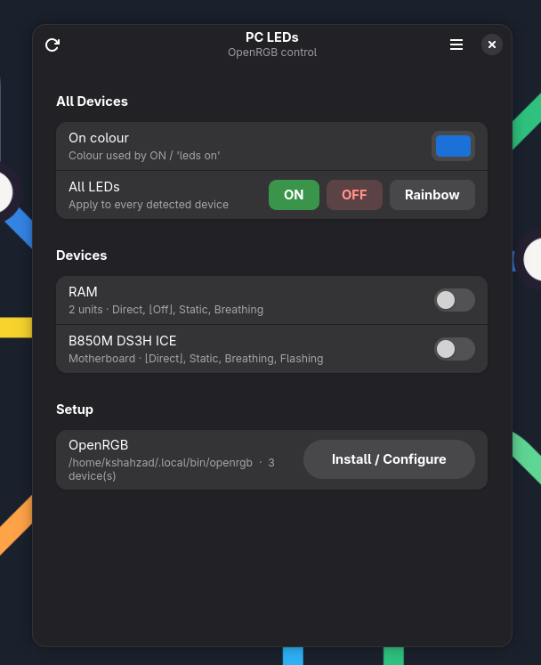

# PC LEDs

> Control every RGB LED on a Linux PC — motherboard ARGB headers, onboard LEDs,
> and RAM — from one CLI command or a small GTK app, and have them **off by
> default at every login**.

[](LICENSE)


`pc-leds` is built on [OpenRGB](https://openrgb.org). Its installer provisions
everything a fresh OS install needs — udev rules, the SMBus kernel parameter,
OpenRGB itself, and ARGB zone sizing — so you never have to hand-configure any
of that again. Reinstall your OS, run **one command**, and your LED setup is
back.

---

## Screenshots

<p align="center">
  
</p>

---

## Table of Contents

- [Screenshots](#screenshots)
- [Features](#features)
- [Why this exists](#why-this-exists)
- [Requirements](#requirements)
- [Installation](#installation)
- [Usage](#usage)
- [The GUI](#the-gui)
- [Configuration](#configuration)
- [Off at login](#off-at-login)
- [How it works](#how-it-works)
- [Troubleshooting](#troubleshooting)
- [Uninstall](#uninstall)
- [Contributing](#contributing)
- [License](#license)

---

## Features

- **One command for everything** — `leds on`, `leds off`, `leds rainbow`,
  `leds toggle`, `leds status`, `leds setup`.
- **A small GTK4 app** (dark theme, OpenRGB-style) with ON/OFF buttons, a
  Rainbow button, a live colour picker, and per-device switches.
- **RAM RGB support** on AMD AM5 boards, including the `acpi_enforce_resources=lax`
  kernel parameter and SMBus diagnostics.
- **Off at login by default** — via XDG autostart or a systemd user service
  (your choice).
- **Portable installer** — distro-aware (native Fedora RPM / Debian DEB, else the
  official AppImage), idempotent, and reusable across OS reinstalls.
- **Fast** — all device commands are batched into a single OpenRGB invocation
  (~2.6 s), with per-boot device caching.

## Why this exists

Getting RAM RGB off on modern AM5 boards is fiddly:

- OpenRGB needs **udev rules** for unprivileged device access.
- RAM RGB sits on the **AMD FCH SMBus**, whose I/O region is often reserved by
  the BIOS's ACPI (`\GSA1.SMBI`), so `i2c_piix4` refuses to bind. The fix is the
  kernel parameter `acpi_enforce_resources=lax`.
- The motherboard's **addressable (ARGB) headers** report **0 LEDs** by default,
  so OpenRGB has nothing to drive until the zones are sized.

`install.sh` handles all three, then drops a `leds` command, a GUI, desktop
launchers, and off-at-login.

## Requirements

- A Linux distribution supported by OpenRGB for your hardware.
- `sudo` access for the one-time system setup (udev rules, kernel parameter,
  OpenRGB).
- For the GUI: GTK4 + PyGObject + libadwaita. The system setup step installs
  them automatically when missing.

## Installation

Clone and install:

```bash
git clone https://github.com/Shahzad-Marth/pc-leds.git ~/pc-leds
cd ~/pc-leds
./install.sh
```

Or fetch and run in one line (review the script first, as always):

```bash
bash <(curl -fsSL https://raw.githubusercontent.com/Shahzad-Marth/pc-leds/main/install.sh)
```

If the installer ends with a **reboot required** message (the SMBus kernel
parameter needs to take effect), reboot once. Then confirm your devices are
visible:

```bash
leds status
```

### Installer options

| Option | Effect |
|---|---|
| `--on-color RRGGBB` | colour used by `leds on` (default `ffffff`) |
| `--argb-size N` | LEDs per addressable header (default `128`) |
| `--autostart-method M` | `xdg` (default), `systemd`, or `none` |
| `--no-udev` | skip udev rules |
| `--no-kernel-param` | skip `acpi_enforce_resources=lax` (RAM RGB will be unavailable) |
| `--no-launchers` | don't create desktop launchers |
| `--no-gui` | don't install the GTK GUI |
| `--skip-system` | user-level steps only (no `sudo`) |

## Usage

Launched from any terminal:

```bash
leds on         # turn every device on (single configurable colour)
leds off        # everything dark (native Off mode where supported)
leds rainbow    # animate: native rainbow effect where supported, else colour-cycle
leds toggle     # flip between on and off
leds status     # show what OpenRGB can see
leds resize     # re-apply ARGB zone size after changing ARGB_SIZE / adding strips
leds setup      # install OpenRGB + configure this machine (distro-aware)
leds gui        # open the graphical app
```

## The GUI

Launch **PC LEDs** from your applications/desktop, or run `pc-leds-gui`
(`leds gui`). It shows every device OpenRGB can see with its supported modes,
and provides:

- **ON** / **OFF** buttons for everything at once, plus a **Rainbow** button.
- **Per-device switches** — the two RAM sticks are grouped into a single
  **RAM** row; switches grey out whenever the "All LEDs OFF" state is active.
- A **live colour picker** — picking a colour applies it immediately while the
  LEDs are on (and stops any running rainbow); it also becomes the colour used
  by the next **ON** / `leds on`.
- An **Install / Configure** button that performs the same distro-aware system
  setup using PolicyKit (`pkexec`) — no terminal required.

**Rainbow** uses each device's own animated effect when it has one that
actually works (RAM: `Rainbow`). Hardware without a usable effect — some boards
report `Color Cycle` but silently ignore it — is animated by the app itself: it
keeps an OpenRGB SDK server for the session and streams a moving rainbow
gradient to the device at ~25 fps (one-shot `openrgb` calls are far too slow
for this). The first click takes a few seconds while the server detects the
hardware; later clicks are instant.

## Configuration

The CLI reads `~/.config/pc-leds/config`:

```sh
ON_COLOR="ffffff"   # colour used by 'leds on'
ARGB_SIZE="128"     # LEDs per addressable header (raise for long strips)
ARGB_ZONES=""       # optional explicit zone indexes, e.g. "0 1 2"
```

`ARGB_SIZE` matters: most ARGB headers are user-sized and default to 0, so a
colour never reaches them until the zone is sized. If you add longer strips and
the last few LEDs stay lit, raise `ARGB_SIZE` and run `leds resize`.

## Off at login

Two interchangeable mechanisms; pick with `--autostart-method`:

- **`xdg`** (default) — `~/.config/autostart/leds-off.desktop`.
- **`systemd`** — a user service at `~/.config/systemd/user/pc-leds-off.service`,
  enabled at `graphical-session.target`. It waits up to 5 s for devices, and
  retries on failure (the `leds off` command exits non-zero when no devices are
  ready yet). Manage it with:

  ```bash
  systemctl --user status pc-leds-off.service
  systemctl --user restart pc-leds-off.service
  ```

Both simply run `leds off` quietly after login.

## How it works

- **`leds off`** — in a single OpenRGB call, sets devices that expose a native
  `Off` mode (e.g. ENE DRAM) to it and paints the rest black.
- **`leds on`** — in a single call, switches every device into `Direct` mode and
  paints it `ON_COLOR` (a bare `-c` would not leave an effect/Off mode).
- **`leds rainbow`** — in a single call, sets each device to its native animated
  `Rainbow`-family effect when it has one; devices without a working effect get
  the ON colour.
- **Speed** — OpenRGB spends ~1.5–2.5 s detecting hardware on every run, so the
  device list is cached per boot (keyed by boot id) and the ARGB zone size is
  applied once — OpenRGB persists it in `sizes.ors`. A normal
  `leds on` / `leds off` is therefore **one** OpenRGB call (~2.6 s).
- **Device selection** — devices are addressed by their index in OpenRGB's
  device list, which is refreshed automatically at the start of each boot.
- **GUI software rainbow** — controllers that list effects but ignore them (the
  Gigabyte board) are animated by the app: it starts an OpenRGB SDK server and
  streams a moving rainbow gradient at ~25 fps, keeping the server for the
  session (so repeat clicks are instant) and stopping it on exit. RAM uses its
  own hardware `Rainbow` effect.
- **Shared system setup** — all root-level work lives in
  `scripts/setup-system.sh`, so the installer (via `sudo`) and the GUI (via
  `pkexec`) reuse exactly the same logic.

## Troubleshooting

- **RAM not detected / `leds status` shows no DRAM device.** The SMBus isn't
  bound. Check `acpi_enforce_resources=lax` is on the kernel cmdline
  (`cat /proc/cmdline`) and `i2c-dev` is loaded. `sudo bash scripts/diagnose-smbus.sh`
  prints the SMBus state.
- **Some ARGB fans/strips stay partly lit.** Raise `ARGB_SIZE` in the config,
  then run `leds resize`.
- **Nothing detected at all.** Confirm `/etc/udev/rules.d/60-openrgb.rules`
  exists, then `sudo udevadm control --reload-rules && sudo udevadm trigger`.
- **GUI won't start.** The GUI needs `python3-gobject`, `gtk4`, `libadwaita`;
  re-run `./install.sh` (or the GUI's Install / Configure) to pull them in.

## Uninstall

```bash
cd ~/pc-leds
./uninstall.sh                                     # user files only
./uninstall.sh --purge-udev --purge-kernel-param   # also system changes
./uninstall.sh --purge-config --purge-openrgb      # also config & OpenRGB
```

## Contributing

Open an issue for bugs or feature requests, or open a pull request. Keep
changes consistent with the existing style:

- CLI logic and helpers live in `bin/leds`.
- GUI code lives in `bin/pc-leds-gui` (GTK4 / libadwaita on system Python).
- System/root automation lives in `scripts/setup-system.sh`.

Include a short `leds status`/`uname -a` snippet in bug reports — device
behaviour varies by controller.

## License

MIT — see [LICENSE](LICENSE).

OpenRGB is a separate project (GPL-2.0); this tool merely drives it via its
command-line interface.